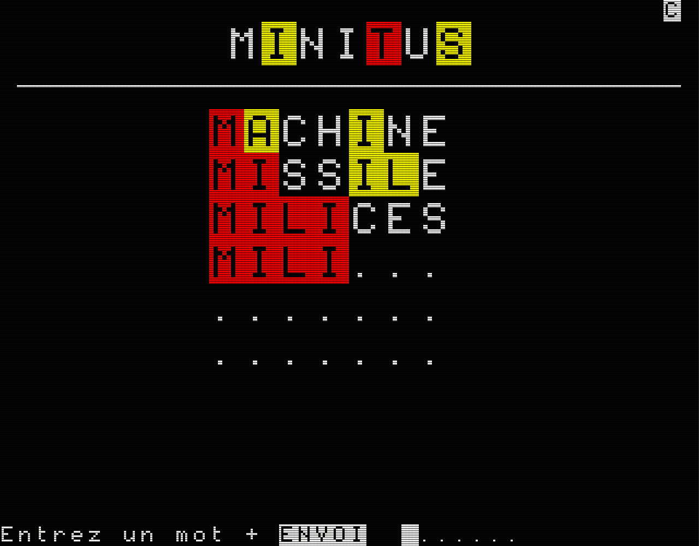
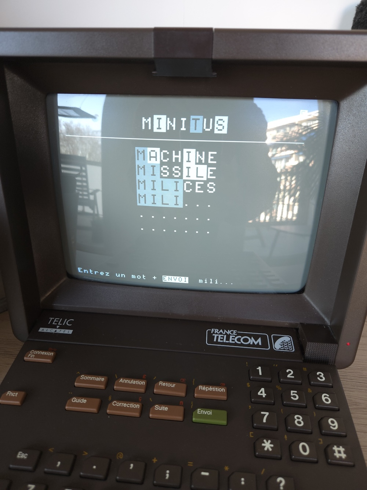

# Minitus

Motus-like sur Minitel, avec un nouveau mot à trouver chaque jour.

<table>
<tr>
<td>



</td>
<td>



</td>
</tr>
</table>

## Comment jouer

Accédez au jeu depuis [MiniPavi](http://www.minipavi.fr/) avec le code `5422*MINITUS`, depuis l'émulateur en ligne ou un vrai Minitel.

## Technologie

Minitus est développée à l'aide de [MiniPavi-Kotlin](https://github.com/outadoc/minipavi-kotlin).

Le code est organisé en trois modules :

- `shared` : la logique du jeu et les écrans, en Kotlin Multiplatform (JVM et JS) ;
- `service` : le serveur Ktor, distribué sous forme d'image Docker ;
- `worker` : le Worker [Cloudflare Workers](https://developers.cloudflare.com/workers/), voir [`worker/README.md`](worker/README.md).

MiniPavi-Kotlin est récupéré depuis GitHub Packages, qui demande un jeton GitHub avec la portée
`read:packages`. Renseignez-le dans `~/.gradle/gradle.properties` :

```properties
gpr.user=<votre identifiant GitHub>
gpr.key=<votre jeton>
```
